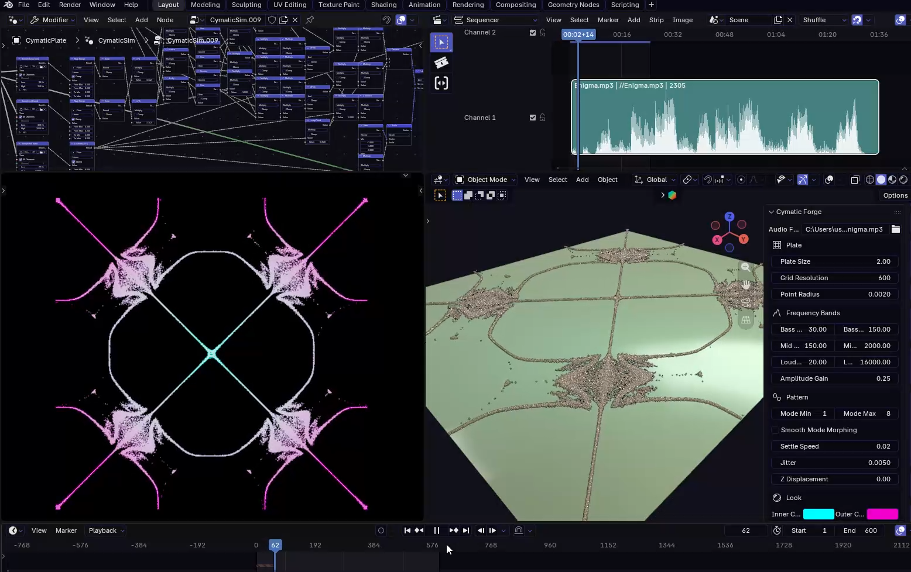
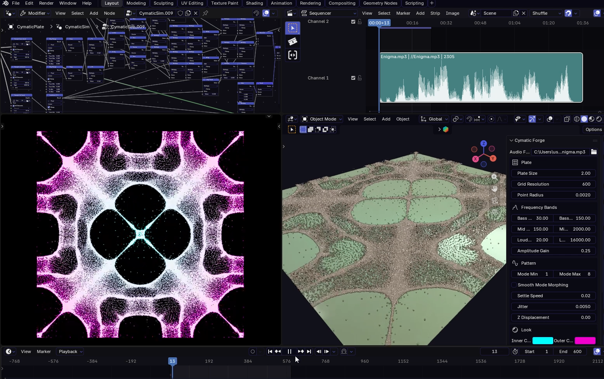

# cymatics-forge
Sound-reactive Chladni plate particle simulation using blender Sample Sound Frequencies node

use audio quality bitrate 170-210 kbps for smooth playback

Minimum blender-version 5.2

