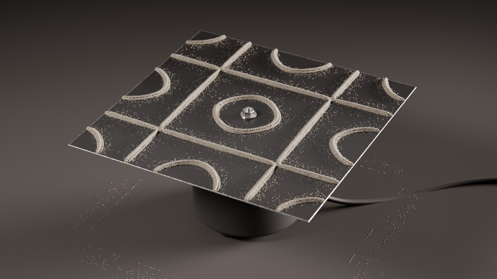
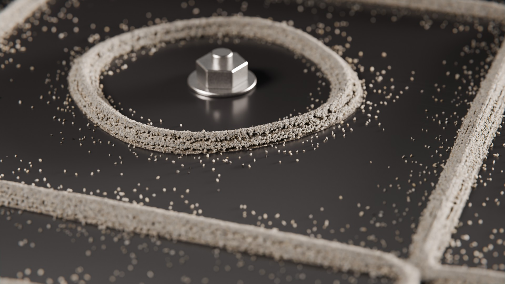
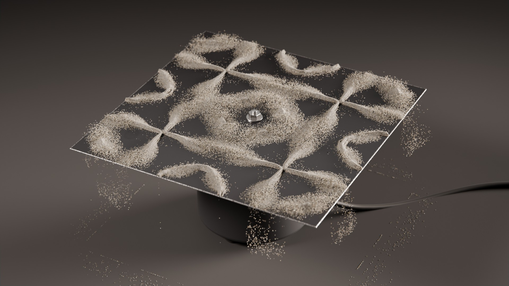
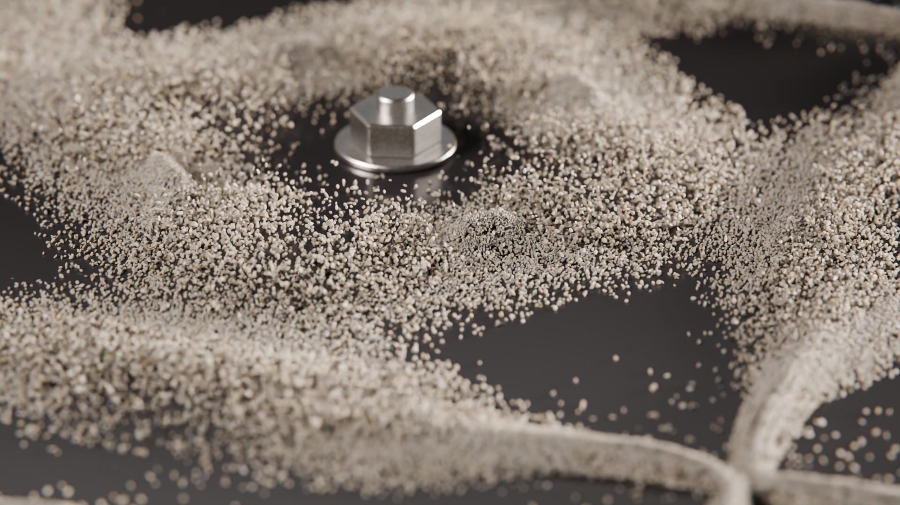

# cymatics-forge
Photoreal, sound-driven Chladni plate for Blender: real sand grains with weight on a vibrating metal plate, lit and shot like a macro product photograph in Cycles.

Minimum Blender version 5.2 (uses the Sample Sound Frequencies node).

Use audio at 170-210 kbps (or .wav/.flac) for smooth playback.

## What it simulates
- **Grains with mass.** A grain only leaves the plate where the local plate acceleration exceeds 1 g. It then flies a ballistic arc under real gravity, tumbles, bounces with sand-like restitution and comes to rest. Sand on the nodal lines never moves, however loud the music; quiet passages leave the pattern frozen.
- **Piles, not points.** Resting sand builds a volume-conserving pile height field. Ridges grow along the nodal lines, avalanche past the angle of repose (33° for dry sand) and creep towards the node while the plate hums below 1 g.
- **Spill.** Sand thrown past the edges falls to the table and stays there.
- **Audio.**
  - Loudness drives the plate. It uses auto-gain, a fast attack and a ring-down release.
  - Bass transients add a kick that makes sand jump.
  - The spectral centroid picks one of 16 real resonance patterns (low pitch → simple, high pitch → intricate). Hysteresis means a pattern holds until the music really moves.
- **Real scale.** The default is a 0.30 m plate with 0.35 mm grains (200k grains ≈ one tablespoon of sand), so depth of field and motion read as real.

## Look
Everything is procedural: there are no image textures or HDRIs.
- **Grain shapes:** rough, fractured quartz sand grains, or translucent salt crystals.
- **Plate finishes:** black anodized, brushed aluminium or brass, each with scratches, fingerprints, dust and edge wear.
- **Apparatus:** a centre bolt and a mechanical wave driver with its cable.
- **Studio:** a seamless backdrop, softbox key, raking rim light and a reflection card.
- **Cameras:**
  - Hero: 90 mm with depth of field.
  - Macro: 100 mm.
  - Top-down.
- **Render settings:** Cycles with AgX and OpenImageDenoise.

## Use
1. In the 3D Viewport sidebar (N) open **Cymatics** and pick an audio file.
2. Choose the medium (sand or salt), the plate finish and size, then click **Build Cymatic Plate**.
3. Press Play from the start frame. The viewport shows grains as points; switch on *Viewport Full Grains* to see the real grain meshes.
4. Click **Bake Simulation** to scrub the timeline and to render.

Every physical and audio setting (Drive, Bass Punch, Ring Down, Hop Height, Angle of Repose, Substeps, …) is a live modifier input. Tweak these settings without rebuilding.

## Renders
All four images are straight Cycles renders of the add-on's default build (no paint-over). Each frame is at 1920×1080 and 128 samples, with a 450k-grain simulation driven by a test track.

Settled pattern: sand has collected on the nodal lines, and a few grains are stuck in between.

The moment the music changes pitch: the plate jumps to a new resonance, sand leaps off the new antinodes, and some pours over the edges onto the table.

## Performance
- **Simulation:** about 0.1 s per frame per 100k grains, measured on 4 CPU cores. Bake before rendering.
- **Rendering:** a 1080p, 128-sample hero frame took about 8 minutes on 4 CPU cores; a desktop GPU should be much faster (not measured). Instanced grains share 8 meshes, so memory stays low.
- **Viewport:** if playback is too slow, lower *Grain Count* or *Substeps* in the modifier. Changing *Grain Count* takes effect from the first frame.
